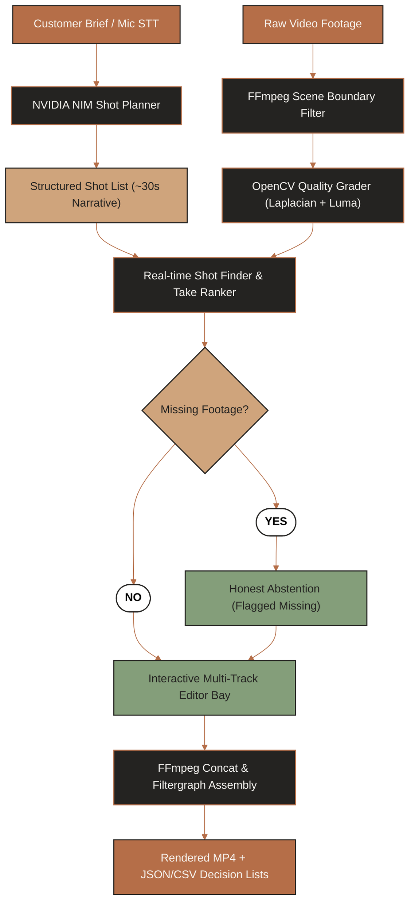

# Smart Rough Cut

AI-powered automatic rough-cut video editing engine. Smart Rough Cut converts customer briefs into structured shot plans using NVIDIA NIM Nemotron reasoning models, dynamically detects scene cuts and frame quality metrics, handles missing takes honestly, supports live audio transcription (STT), and renders frame-accurate rough cuts with FFmpeg.

---

## 1. System Architecture & Workflow



---

## 2. Dynamic Scene Detection & Quality Algorithm

```mermaid
%%{init: {'theme': 'base', 'themeVariables': { 'primaryColor': '#242321', 'primaryTextColor': '#f7f5f1', 'primaryBorderColor': '#b56e48', 'lineColor': '#b56e48', 'secondaryColor': '#f7f5f1', 'tertiaryColor': '#dedad3' }}}%%
flowchart LR
    classDef dark fill:#242321,stroke:#b56e48,stroke-width:1.5px,color:#f7f5f1;
    classDef rust fill:#b56e48,stroke:#242321,stroke-width:1.5px,color:#f7f5f1;
    classDef amber fill:#cfa47c,stroke:#242321,stroke-width:1.5px,color:#242321;
    classDef sage fill:#849e7a,stroke:#242321,stroke-width:1.5px,color:#242321;

    V["Source Video"]:::rust --> SC["FFmpeg Scene Boundary Extraction"]:::dark
    SC --> B["Boundary Timestamps [t0, t1, t2...]"]:::amber
    B --> QC["OpenCV Frame Evaluation"]:::dark
    QC --> SH["Sharpness (Laplacian Var)"]:::sage
    QC --> LU["Exposure Balance (Luma Mean)"]:::sage
    SH & LU --> QS["Normalized Quality Score (20-98%)"]:::amber
    QS --> MM["Best Take + Up to 2 Alternatives Selected"]:::rust
```



---

## 3. Quick Start

### 1. Backend Setup
```bash
cd backend
pip install -r requirements.txt
python -m uvicorn app.main:app --host 127.0.0.1 --port 8000 --reload
```
- API Health Check: `http://127.0.0.1:8000/`
- Swagger Documentation: `http://127.0.0.1:8000/docs`

### 2. Frontend Setup
```bash
cd frontend
npm install
npm run dev
```
- App UI: `http://localhost:3000`

---

## 4. Key Features

- **NVIDIA NIM Nemotron Planning**: Deconstructs free-text or spoken briefs into shot plans categorized by tags (`OPEN`, `PROCESS`, `HERO`, `PEOPLE`, `DETAIL`, `AUDIO`, `MOMENT`, `END`).
- **Real-Time Scene Intelligence**: Detects scene transitions via FFmpeg and grades sharpness and lighting balance with OpenCV.
- **Microphone STT Input**: Real-time microphone audio capture stream directly converted to text via speech recognition.
- **Honest Missing Take Detection**: Correctly flags missing footage (e.g., ribbon cutting or spoken welcome lines) rather than hallucinating bad takes.
- **Interactive Multi-Track Editor**: Boundary trimming, shot reordering, take swapping, and undo/redo state management.
- **Dual Formats Export**: Conformed 720p 30fps MP4 rough cut alongside frame-accurate CSV and JSON clip decision lists.
